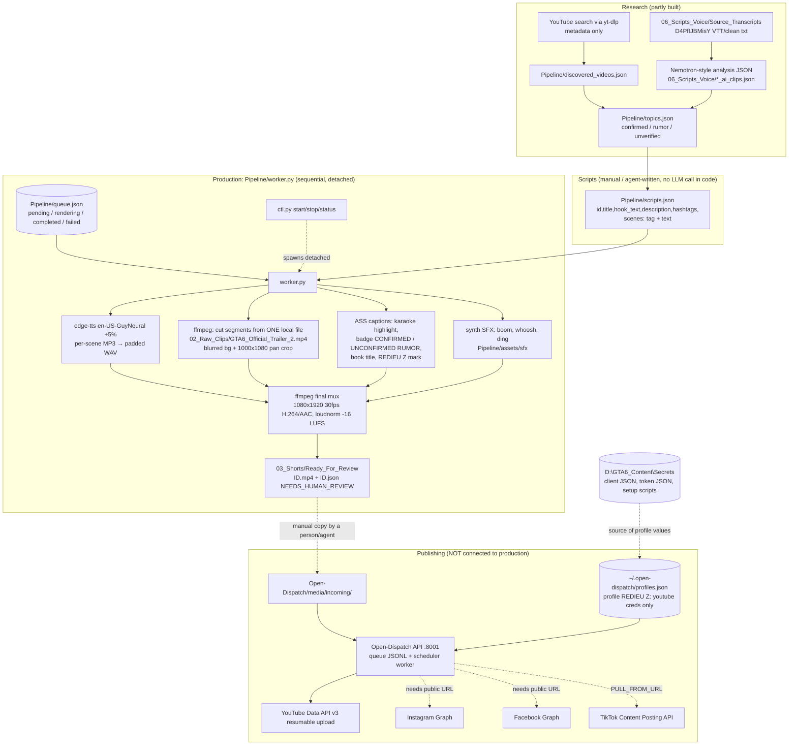
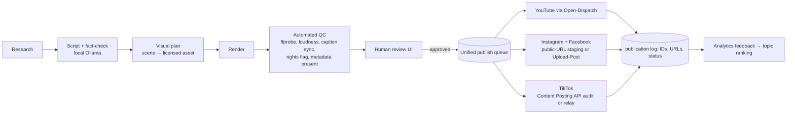

# Architecture and Data Flow (Verified Current State vs Target)

Audit date: 2026-11-12. **[V]** verified in source/config/live · **[P]** planned or unverified.
Intended workflow (aspirational) lives in `03_Architecture/SYSTEM_ARCHITECTURE.md`. This file records what is actually wired today.

---

## 1. Current state — what exists and how it connects



Dotted edges are links that are either manual, unverified, or blocked by a constraint described in `GAPS_BUGS_RISKS.md`.

### Components that exist but are NOT in the data path today
| Component | Why it is not used | Possible use |
|---|---|---|
| PurffleShorts | Pipeline reimplements a subset; no code calls it | Crosspost (Instagram direct, Upload-Post), scheduling, SEO, Studio |
| MoneyPrinterTurbo | Only its venv interpreter (for `edge-tts`) is borrowed | Material/script matching, BGM, subtitle animation |
| Chopify | No long recordings exist (`01_PS5_Recordings` empty) | Clip own captures |
| Ollama (gemma4, qwen3) | No script generation step calls it | Local script drafting, fact-check pass |

---

## 2. Data contracts [V]

### `Pipeline/scripts.json` (input to renderer)
```json
[{ "id": "GTA6_Short_0NN", "title": "…", "hook_text": "UPPERCASE HOOK",
   "description": "…", "hashtags": ["#GTA6", "…"],
   "scenes": [ { "tag": "hook|confirmed|rumor|cta", "text": "narration sentence(s)" } ] }]
```
`tag` drives the on-screen badge: `confirmed` → green "CONFIRMED BY ROCKSTAR", `rumor` → orange "UNCONFIRMED RUMOR", `hook`/`cta` → no badge. There is **no** field mapping a scene to footage.

### `Pipeline/queue.json`
```json
{ "items": [ { "id": "GTA6_Short_0NN", "title": "…", "status": "pending|rendering|completed|failed",
               "attempts": 0, "error": null, "output": "D:\\…\\ID.mp4",
               "started": "ISO-8601", "finished": "ISO-8601" } ] }
```
Written atomically (`tmp` + `os.replace`). On worker start, `rendering` items are reset to `pending`. One automatic retry (`MAX_ATTEMPTS = 2`); duration outside 25–45 s is a non-retryable `ScriptError`.

### `Ready_For_Review/<ID>.json` (sidecar, written per render)
`title, hook_text, description, hashtags, channel, duration_s, voice, status = NEEDS_HUMAN_REVIEW, scenes[{tag,text}], footage_note, rendered`. `footage_note` records that the visuals are clips of a local official-trailer file for editing tests with **rights not cleared**.

### Open-Dispatch unit (YouTube) [V from adapter]
`formats.youtube_short = { video_path (relative to media root), title?, description?, tags?, privacy: public|unlisted|private }` plus `profile_id` on the unit so the worker injects the profile's credentials. **`privacy` defaults to `public` when omitted.**

---

## 3. Render stage detail (`Pipeline/worker.py`) [V]

1. For each scene: `edge_tts.Communicate(text, voice, rate="+5%")` → MP3; padded 0.30 s → WAV; scene length = padded WAV length. Total must be 25–45 s.
2. Footage: the single file `02_Raw_Clips/GTA6_Official_Trailer_2.mp4` (1920×1080, ≈166.7 s). Per scene, a start offset derived from `(item_index*29 + scene*37 + 12)`; segment = blurred full-frame background + 1000×1080 panning crop scaled to 1080 wide, centred slightly high.
3. Captions: ASS file; words timed **proportionally to character length** across the scene's speech duration (not true word alignment); 3-word chunks, `\kf` karaoke fill; Impact 96 pt, bottom margin 380 px.
4. Overlays: hook title for the first 2.6 s (centre); status badge per scene at top (margin 125 px); text mark `REDIEU Z` top-right (margin 55 px, ~50 % opacity).
5. Audio: voice + synthesised boom (t=0), whoosh at each scene cut, ding at the CTA; `amix` + `loudnorm I=-16`. **No music bed.**
6. Encode: libx264 CRF 19 preset medium, AAC 192 k, `+faststart`; verified 1080×1920 and duration ≥ 25 s before moving to `Ready_For_Review`.
7. Typical runtime ≈ 10–30 s per video on this machine (observed in `production.log`).

## 4. Process model [V]
- `ctl.py start` launches `worker.py` with the MoneyPrinterTurbo venv interpreter using Windows creation flags `DETACHED_PROCESS | CREATE_NEW_PROCESS_GROUP | CREATE_NO_WINDOW` (+ `BREAKAWAY_FROM_JOB`, with fallback). `worker.pid` stores the worker's own PID; the venv launcher is a separate parent process.
- `ctl.py stop` runs `taskkill /T /F` on the worker PID and resets `rendering → pending`.
- Logs: `Pipeline/logs/production.log`, `ffmpeg_<ID>.log`, `worker_stdout.log`. Human-readable status: `Pipeline/STATUS.md`.
- The worker exits when no `pending` items remain; it is **not** a long-lived service.

## 5. Publishing path, as implemented by Open-Dispatch [V]
```
POST /dispatch (or Compose UI) → queue row (JSONL) → scheduler worker (must be running)
  → with profile_env(profile): adapter.publish(unit, account) → platform API → result/URL stored on the row
```
- Worker liveness is a heartbeat file; `/healthz` showed it **not running** at audit time.
- Retries with backoff are handled by the worker (`WORKER_MAX_ATTEMPTS`, `WORKER_BACKOFF_BASE` in `.env`).

---

## 6. Target architecture [P — roadmap, nothing below exists yet]


Design rules carried over from the project docs: stages separate; a failed publish never deletes a render; a failed render never deletes a script; no public upload without explicit approval.
